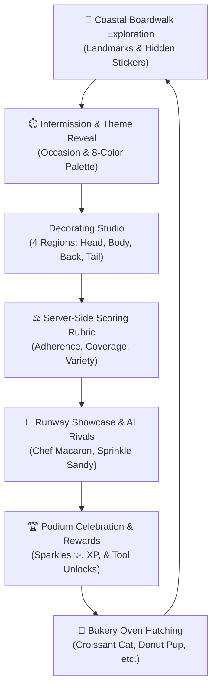

# 🍰 Roblox 1: Style a Snack

[](https://www.roblox.com)
[](https://luau.org/)
[](https://github.com/ajaykumar-wq/Roblox1-Style-a-Snack)
[](https://github.com/ajaykumar-wq/Roblox1-Style-a-Snack.git)
[](docs/NOTION_SETUP_GUIDE.md)

> A vibrant pastry-meets-creature 3D decorating and fashion runway showcase game on Roblox. Bake, frost, sprinkle, and style whimsical snack animals (Croissant Cats, Donut Pups, Taco Turtles), compete against simulated AI rivals under strict server judging rubrics, explore a coastal boardwalk with 5 landmarks, and hatch rare creatures from the magical Bakery Oven!

---

## 📑 Table of Contents

- [Quick Documentation Links](#-quick-documentation-links)
- [Game Overview & High-Concept Pitch](#-game-overview--high-concept-pitch)
- [The Core Gameplay Loop](#-the-core-gameplay-loop)
- [Key Systems & Features](#-key-systems--features)
  - [1. 3D Snack Creature Decorating](#1-3d-snack-creature-decorating)
  - [2. Server-Side Judging & AI Rivals](#2-server-side-judging--ai-rivals)
  - [3. Bakery Oven Hatching & Rarity Tiers](#3-bakery-oven-hatching--rarity-tiers)
  - [4. Coastal Boardwalk & 5 Landmarks](#4-coastal-boardwalk--5-landmarks)
  - [5. 6-Level Progression Tree](#5-6-level-progression-tree)
  - [6. Economy & Sparkle Ledger](#6-economy--sparkle-ledger)
- [Codebase Architecture & File Tree](#-codebase-architecture--file-tree)
- [Roblox Studio & Antigravity Setup](#-roblox-studio--antigravity-setup)
- [Git Remote & Backup Instructions](#-git-remote--backup-instructions)
- [Notion Project Hub & Tracking](#-notion-project-hub--tracking)
- [QA Testing & Quality Assurance](#-qa-testing--quality-assurance)
- [Roadmap & Release Milestones](#-roadmap--release-milestones)

---

## 🔗 Quick Documentation Links

| Document | Purpose | File Location |
| :--- | :--- | :--- |
| **Game Flow & Gameplay Guide** | Complete breakdown of the 60s first minute, player-started rounds, 3 judges, and Gate 1 criteria | [`docs/GAME_FLOW_GUIDE.md`](docs/GAME_FLOW_GUIDE.md) |
| **Notion Workspace Guide** | Blueprint for setting up Notion databases and views | [`docs/NOTION_SETUP_GUIDE.md`](docs/NOTION_SETUP_GUIDE.md) |
| **Game Changes Tracker** | Release notes, patch history, and commit logs | [`docs/GAME_CHANGES_TRACKER.md`](docs/GAME_CHANGES_TRACKER.md) |
| **Feature Roadmap Tracker** | Sprint backlog, Kanban tasks, and technical criteria | [`docs/FEATURE_ROADMAP_TRACKER.md`](docs/FEATURE_ROADMAP_TRACKER.md) |
| **QA Test Reports & Bug Tracker** | Test execution reports, test matrices, and bug schemas | [`docs/TEST_REPORTS_TRACKER.md`](docs/TEST_REPORTS_TRACKER.md) |
| **Architecture Specification** | Deep dive into services, controllers, and remotes | [`docs/ARCHITECTURE.md`](docs/ARCHITECTURE.md) |

---

## 🥐 Game Overview & High-Concept Pitch

In **Style a Snack**, players step onto a sunny coastal boardwalk where food comes alive as adorable companions. 
Players dress and customize their pastry animals to match dynamic runway themes (e.g., *Beach Day*, *Royal Gala*, *Space Camp*), utilizing specialized culinary tools like glossy icings, star pearl sprinkles, edible stickers, and caramel drizzles. 

Submissions are evaluated in real time by an impartial server-side judge across palette adherence, body coverage, tool variety, and theme alignment. Players compete against other players or AI rival bakers, take the winner's podium, earn **Sparkle (✨)** currency, and unlock new tools and rare creature species.

---

## 🔁 The Core Gameplay Loop



1. **Boardwalk Exploration**: Roam freely along the boardwalk, interact with NPCs, and discover 5 hidden collector stickers.
2. **Warmup / Theme Reveal**: First-timers complete a 60-second guided icing warmup; experienced bakers receive an occasion and an 8-color palette.
3. **Decorating Studio**: Target 4 anatomical regions (`head`, `body`, `back`, `tail`) using up to 12 stacked layers of icing, sprinkles, stickers, drizzles, and patterns.
4. **Server-Side Judging**: The server calculates an objective 100-point rubric score and awards 1 to 5 Stars.
5. **Runway Showcase & AI Rivals**: In single-player mode, simulated competitors (*Chef Macaron*, *Sprinkle Sandy*) walk the runway with generated scores.
6. **Podium & Rewards**: Top placements take the winners' pedestals, earning Sparkles (✨) and progressing through 6 milestone ranks.
7. **Bakery Oven**: Spend Sparkles at the community oven to hatch new snack creature species with a built-in bad-luck pity counter.

---

## ✨ Key Systems & Features

### 1. 3D Snack Creature Decorating
- **4 Anatomical Regions**: `head`, `body`, `back`, `tail`
- **6 Specialized Tools**:
  - 🍦 **Icing**: Base smooth frosting layer with theme palette swatches.
  - ✨ **Sprinkles**: Up to 60 scattered pieces (Rainbow Pills, Star Pearls, Chocolate Flakes).
  - 🏷️ **Stickers**: Edible stickers collected from coastal landmarks (Stars, Hearts, Shells).
  - 🍯 **Drizzle**: Glossy zig-zag and swirl caramel/chocolate lines.
  - 🏁 **Patterns**: Checkerboards, polka dots, and tiger stripes.
  - 🎀 **Accessories**: Hats, bows, and miniature sunglasses.
- **Layer Stacking**: Supports up to 12 layers with rendering priority order and undo/clear controls.

### 2. Server-Side Judging & AI Rivals
- **100-Point Scoring Rubric**:
  - **Palette Adherence (40 pts)**: Strict verification that colors match theme swatches.
  - **Body Coverage (30 pts)**: Rewards decorating across all 4 body regions.
  - **Tool Variety (20 pts)**: Points for combining icings, sprinkles, and stickers.
  - **Occasion Bonus (10 pts)**: Bonus for matching theme tags.
- **Rival AI Competitors**: When playing solo or in small servers, `RivalService` generates NPC competitors with unique styling archetypes so rounds never feel empty.

### 3. Bakery Oven Hatching & Rarity Tiers
- **Species Roster**: *Croissant Cat*, *Donut Pup*, *Taco Turtle*, and more.
- **Rarity Breakdown**:
  - ⚪ **Common** (60%)
  - 🟢 **Uncommon** (25%)
  - 🔵 **Rare** (10%)
  - 🟣 **Epic** (4%)
  - 🟠 **Mythic** (1%)
- **Bad-Luck Pity Counter**: Guarantees a Rare or better creature within 10 hatches.
- **Duplicate Conversion**: Duplicate creatures automatically convert to bonus Sparkles.

### 4. Coastal Boardwalk & 5 Landmarks
- 🗼 **Lighthouse**: High observation gallery with hidden Star sticker.
- 🎡 **Ferris Wheel**: Sky gondola vantage point with hidden Balloon sticker.
- 🍬 **Candy Stand**: Confectionery jars hiding the Heart sticker.
- 🎣 **Fishing Dock**: Wooden bait pier hiding the Fish sticker.
- 🌊 **Tide Pools**: Rocky coastal pools with the Shell sticker.

### 5. 6-Level Progression Tree
| Level | Title | Objective | Reward |
| :--- | :--- | :--- | :--- |
| **1** | The Starter Snack | Complete 60s warmup round | **Sprinkles Tool** + 20 ✨ |
| **2** | Sweet Scatter | Score 2+ Stars on Runway | **Stickers Tool** + 40 ✨ |
| **3** | The Oven Baker | Hatch first snack creature | **Free Hatch** + 50 ✨ |
| **4** | Glossy Glaze | Score 3+ Stars matching palette | **Drizzle Tool** + 60 ✨ |
| **5** | Runway Spotlight | Place Top 3 on the podium | **Patterns Tool** + 100 ✨ |
| **6** | Runway Royalty | Decorate all 4 regions & score 4+ Stars | **Master Baker Trophy** + 150 ✨ |

### 6. Economy & Sparkle Ledger
- **Sparkle Currency (✨)**: Used for tool unlocks and oven baking.
- **Immutable Transaction Ledger**: Every credit and debit is tracked with timestamp, reason, amount, and running balance inside `DataService`.

---

## 📁 Codebase Architecture & File Tree

```
D:\personal\AI-Projects\roblox game\
├── .gitignore                          # Git ignore rules for Roblox
├── README.md                           # Main project documentation (this file)
│
├── docs/                               # Project & Notion Documentation
│   ├── ARCHITECTURE.md                 # System architecture & technical specs
│   ├── NOTION_SETUP_GUIDE.md           # Guide to setting up Notion workspace
│   ├── GAME_CHANGES_TRACKER.md         # Notion database: releases & changelogs
│   ├── FEATURE_ROADMAP_TRACKER.md      # Notion database: sprint backlog & tasks
│   └── TEST_REPORTS_TRACKER.md         # Notion database: QA test runs & bugs
│
└── src/
    ├── client/                         # Client Code (StarterPlayerScripts)
    │   ├── init.client.luau            # Client bootstrapper
    │   └── StyleASnack/
    │       ├── MainClient.client.luau  # Main client initialization
    │       └── Controllers/
    │           ├── AudioController.luau     # Dynamic sound effects
    │           ├── DecorateController.luau  # 3D decorating tool raycasting
    │           ├── UIController.luau        # HUD & modal state dispatcher
    │           ├── UIIndexModal.luau        # Species index & compendium
    │           ├── UIMapModal.luau          # Boardwalk map & landmark tracker
    │           ├── UIOvenModal.luau         # Bakery oven hatching modal
    │           ├── UIResultsHUD.luau        # Runway score breakdown & stars
    │           ├── UIThemeChoice.luau       # Theme & palette announcement
    │           └── ViewController.luau      # Camera mode controller
    │
    ├── server/                         # Server Code (ServerScriptService)
    │   ├── init.server.luau            # Server bootstrapper
    │   └── StyleASnack/
    │       ├── MainServer.server.luau  # Main server initialization
    │       └── Services/
    │           ├── AnalyticsService.luau    # Telemetry & player retention
    │           ├── DataService.luau         # ProfileStore & Sparkle ledger
    │           ├── EconomyService.luau      # Currency & transactions
    │           ├── ExplorationService.luau  # 5 Landmarks & sticker discovery
    │           ├── OvenService.luau         # Baking, rarities, & pity counter
    │           ├── RivalService.luau        # AI competitor generation
    │           ├── RoundService.luau        # Core round loop state machine
    │           ├── ServerJudgeService.luau  # 100-pt rubric & star evaluation
    │           ├── VoteService.luau         # Multiplayer runway voting
    │           └── WarmupService.luau       # 60-second guided onboarding
    │
    └── shared/                         # Shared Code (ReplicatedStorage)
        ├── Constants.luau              # Global gameplay constants
        └── StyleASnack/
            ├── Network/
            │   └── Remotes.luau        # Type-safe RemoteEvents & Functions
            └── Config/
                ├── DecorationConfig.luau   # Tools, slots, & layer constraints
                ├── EconomyConfig.luau      # Costs, prices, & reward tables
                ├── ExplorationConfig.luau  # Landmark coordinates & clues
                ├── ProgressionConfig.luau  # 6-level progression objectives
                ├── SpeciesConfig.luau      # Creature species definitions
                └── ThemeConfig.luau        # 12 Occasions & color palettes
```

---

## 🛠️ Roblox Studio & Antigravity Setup

### 1. Linking Antigravity with Roblox Studio
Antigravity communicates directly with your active Roblox Studio session using the built-in **Roblox Studio MCP Proxy**.

1. Launch **Roblox Studio** and open your place (or a standard Baseplate).
2. Open the **Assistant** window in the top-right toolbar.
3. Click the `⋯` (three dots menu) on the Assistant panel and choose **Manage MCP Servers**.
4. Enable **Enable Studio as MCP server**.
5. Antigravity will now automatically detect your Studio session, allowing live script editing, hierarchy inspection, asset creation, and playtesting.

### 2. File Synchronization with Rojo (Optional)
If using Rojo for disk-to-Studio synchronization:
```bash
# Start Rojo server
rojo serve default.project.json
```
Install the Rojo plugin in Studio and click **Connect**.

---

## 🚀 Git Remote & Backup Instructions

The git remote has been configured to target the official repository:
```bash
git remote add origin https://github.com/ajaykumar-wq/Roblox1-Style-a-Snack.git
```

### How to Push Your Code & Back It Up to GitHub

If you see `repository not found` when running `git push`:
1. Make sure you have created the repository on your GitHub account:
   - Go to [https://github.com/new](https://github.com/new)
   - Repository name: **`Roblox1-Style-a-Snack`**
   - Visibility: Public or Private
   - Do **NOT** initialize with a README, .gitignore, or license (we already have them here!).
2. Ensure you are authenticated with GitHub:
   - Run: `git push -u origin main`
   - Windows Credential Manager will prompt you for your GitHub credentials or a **Personal Access Token (PAT)**.
3. Verify your push:
   - Visit: `https://github.com/ajaykumar-wq/Roblox1-Style-a-Snack`

---

## 📓 Notion Project Hub & Tracking

To track updates, feature progress, and QA test reports in Notion:
1. Open the [`docs/NOTION_SETUP_GUIDE.md`](docs/NOTION_SETUP_GUIDE.md) document.
2. In Notion, create a new workspace or page titled **Style a Snack - Project HQ**.
3. Use Notion's **Import Markdown** feature to import:
   - [`docs/GAME_CHANGES_TRACKER.md`](docs/GAME_CHANGES_TRACKER.md) ➔ Changelog & Version History
   - [`docs/FEATURE_ROADMAP_TRACKER.md`](docs/FEATURE_ROADMAP_TRACKER.md) ➔ Sprint Backlog & Kanban
   - [`docs/TEST_REPORTS_TRACKER.md`](docs/TEST_REPORTS_TRACKER.md) ➔ QA Test Runs & Bug Tracker

---

## 🧪 QA Testing & Quality Assurance

All game features undergo rigorous validation before release. 

- **Latest Certified Run**: `TR-001` (October 25, 2026)
- **Target Git Ref**: Commit `01f92ba`
- **Result**: **100% Pass Rate (24/24 Test Cases)**
- **Coverage**:
  - Warmup 60-second timer and guided icing tutorial
  - 4-Region 3D decorating tool mechanics (up to 12 layers)
  - Server-side 100-point rubric calculation & star ratings
  - AI rival competitor generation for solo play
  - Bakery oven creature hatching with bad-luck pity counter
  - 5 Coastal landmarks & hidden collector stickers
  - Sparkle currency ledger & DataService audit trail

For full testing logs, step-by-step procedures, and bug schemas, see [`docs/TEST_REPORTS_TRACKER.md`](docs/TEST_REPORTS_TRACKER.md).

---

## 🗺️ Roadmap & Release Milestones

- [x] **Stage 1: Single-Player Core Loop (v0.1.0)**
  - 60s Warmup mode, 5 Landmarks, 6 Progression Levels, Server Judging, AI Rivals, Oven Hatching.
- [ ] **Stage 2: Multiplayer Runway & Social Voting (v0.2.0)**
  - Real-time player voting, cheer reactions, runway camera transitions, celebratory particle VFX.
- [ ] **Stage 3: Bakery Stalls & Economy Expansion (v0.3.0)**
  - Customizable boardwalk bakery stalls, creature trading, VIP passes, and seasonal theme packs.
- [ ] **Stage 4: UGC & Live Boardwalk Events (v1.0.0)**
  - Community snack creator contests, weekend food festivals, and mobile touch optimizations.

---

*Developed with ❤️ for the Roblox Community. Powered by Antigravity AI & Luau.*
