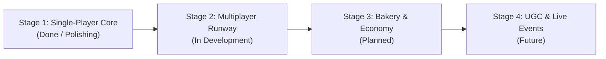

# 📋 Feature Roadmap & Sprint Backlog Tracker
### Project: Style a Snack (Roblox1) | Repository: [ajaykumar-wq/Roblox1-Style-a-Snack](https://github.com/ajaykumar-wq/Roblox1-Style-a-Snack.git)

> **Notion Import Tip**: Create a **Kanban Board** in Notion with columns for **Status** (`Backlog`, `In Design`, `In Development`, `Ready for QA`, `Done`) and swimlanes for **Milestone / Stage**.

---

## Roadmap Milestones Overview



---

## 1. Active Feature Database Table

| ID | Feature / Task Name | Milestone | Domain | Priority | Status | Target Files | QA Signoff |
| :--- | :--- | :--- | :--- | :--- | :--- | :--- | :--- |
| **FEAT-101** | Single-Player Core Round Loop | Stage 1 | Server Scripting | 🔴 P0 | `Done` | `RoundService.luau` | Passed ✅ |
| **FEAT-102** | 60-Second Guided Warmup Mode | Stage 1 | Server / Client | 🔴 P0 | `Done` | `WarmupService.luau`, `UIController.luau` | Passed ✅ |
| **FEAT-103** | Server-Side 100-Point Scoring Rubric | Stage 1 | Server Scripting | 🔴 P0 | `Done` | `ServerJudgeService.luau` | Passed ✅ |
| **FEAT-104** | AI Rival Competitor Generator | Stage 1 | Server Scripting | 🟠 P1 | `Done` | `RivalService.luau` | Passed ✅ |
| **FEAT-105** | Bakery Oven Creature Hatching | Stage 1 | Server / UI | 🟠 P1 | `Done` | `OvenService.luau`, `UIOvenModal.luau` | Passed ✅ |
| **FEAT-106** | 5 Coastal Landmarks & Hidden Stickers | Stage 1 | Exploration | 🟡 P2 | `Done` | `ExplorationService.luau`, `UIMapModal.luau` | Passed ✅ |
| **FEAT-107** | 6-Level Linear Progression & Unlocks | Stage 1 | Economy / Data | 🟠 P1 | `Done` | `ProgressionConfig.luau`, `DataService.luau` | Passed ✅ |
| **FEAT-108** | Modular Audio Feedback System | Stage 1 | Audio / VFX | 🟡 P2 | `Done` | `AudioController.luau` | Passed ✅ |
| **FEAT-201** | Multi-Player Runway Walk & Real-time Voting | Stage 2 | Server / Client | 🔴 P0 | `In Development` | `VoteService.luau`, `RoundService.luau` | Pending ⏳ |
| **FEAT-202** | Player Emote & Cheer Reaction Bar | Stage 2 | Client UI | 🟡 P2 | `In Design` | `src/client/StyleASnack/Controllers/` | Pending ⏳ |
| **FEAT-203** | 3D Runway Lighting & Confetti Particle VFX | Stage 2 | Art / VFX | 🟡 P2 | `In Design` | Workspace / ReplicatedStorage | Pending ⏳ |
| **FEAT-204** | Spectator Orbit Camera Mode | Stage 2 | Client Camera | 🟢 P3 | `Backlog` | `ViewController.luau` | Pending ⏳ |
| **FEAT-301** | Player Bakery Stall Customization | Stage 3 | Building / Data | 🟠 P1 | `Backlog` | `DataService.luau`, World Models | Pending ⏳ |
| **FEAT-302** | Snack Trading & Showcase Pedestals | Stage 3 | Economy | 🟡 P2 | `Backlog` | `EconomyService.luau` | Pending ⏳ |
| **FEAT-303** | Premium VIP Pass & Seasonal Themes | Stage 3 | Monetization | 🟠 P1 | `Backlog` | `MarketplaceService` integration | Pending ⏳ |
| **FEAT-401** | Weekend Boardwalk Food Festival Event | Stage 4 | Live Ops | 🟡 P2 | `Backlog` | World Scripts | Pending ⏳ |
| **FEAT-402** | Community Snack Creator Contest | Stage 4 | Community / UGC | 🟢 P3 | `Backlog` | Asset Moderation Pipeline | Pending ⏳ |

---

## 2. Feature Specification Card Template

Use this format when drafting new feature tickets in Notion:

```markdown
### [FEAT-###] Feature Title

#### 🎯 Goal & Player Impact
- Why are we building this?
- What player fantasy does it fulfill?

#### 📐 Design & UX Requirements
- Visual mockups / wireframes
- Key user flows (Step 1 ➔ Step 2 ➔ Step 3)
- Sound and haptic feedback requirements

#### 💻 Technical Architecture
- **Server Services Involved**: e.g., `RoundService`, `DataService`
- **Client Controllers Involved**: e.g., `UIController`, `DecorateController`
- **Network Remotes Required**:
  - `RemoteEvent`: e.g., `OnPlayerVoteCast(targetUserId: number, score: number)`
  - `RemoteFunction`: e.g., `RequestRunwayLineup(): { Contestants }`

#### 📋 Acceptance Criteria
- [ ] Requirement 1 verified in Studio PlaySolo
- [ ] Requirement 2 verified in 2-Player Local Server
- [ ] No client errors or unhandled nil exceptions in output console
- [ ] Mobile touch tap targets minimum 44x44px
- [ ] DataStore serialization conforms to schema versioning
```
