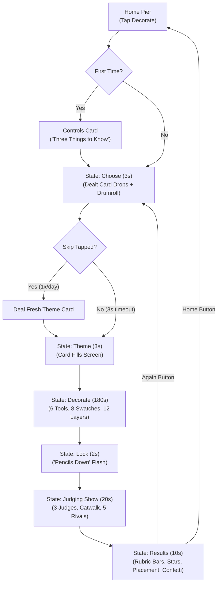

# 🎮 Style a Snack: Definitive Game Flow & Gameplay Guide
### Stage 1: Single-Player Core Prototype | Reference: Prototype GDD (Oct 24–25, 2026)

---

## 1. Executive Purpose & Scope

The **Stage 1 Prototype** proves that a new player can **create a pet, decorate it, receive a server-judged score, and earn rewards inside 60 seconds**, building immediate attachment and driving Day-1 retention without relying on multiplayer lobbies or matchmaking queues.

### 🎯 Gate 1 Success Criteria (Week 4, 50-Player Wave-1 Cohort)

| Metric | Target / Gate 1 Criterion | Verification Method |
| :--- | :--- | :--- |
| **First Judge Score** | **≥ 90%** of first-time players scored inside 60 seconds | `first_judge_score` analytics event |
| **Round Completion** | **≥ 60%** of first-time players finish their first standard round | `round_completed` analytics event |
| **Day-1 Retention** | **≥ 35%** return rate the following day | Telemetry session tracker |
| **Exploration Reach** | **≥ 70%** visit ≥ 3 of 5 landmarks; **≥ 50%** find ≥ 1 hidden sticker | `landmark_visited`, `sticker_found` |
| **Performance Floor** | **30 FPS** on low-end mobile with 6 decorated creatures and full boardwalk loaded; memory < 1 GB | `device_perf` p50/p95 metrics |
| **Server Authority** | Zero client-trusted grants (all Sparkles, XP, scoring, and rolls run on server) | Code audit of `EconomyService`, `DataService`, `ServerJudgeService` |
| **Tool Clarity** | **≥ 70%** of testers use unlocked tools without needing a tutorial | `tool_used` frequency metrics |

---

## 2. The "First Minute" Script (0:00 to 1:00)

The first minute is strictly choreographed to give players a pet, tactile feedback, and their first applause before fatigue can set in:

```mermaid
timeline
    title The First 60 Seconds
    0:00 - 0:05 : Spawn on Sprinkle Harbor Pier
    0:05 - 0:25 : Meet Your Snackimal (Creator : 3 Steps or Surprise Me)
    0:25 - 0:50 : Warm-Up Decorate Round (25s : Icing & Sprinkles on Cat)
    0:50 - 1:00 : Runway & Judging Show (10s : 2 Rivals & Stars)
    1:00        : First Score Lands! (+20 ✨ Sparkles, Level Up, Sprinkles Unlocked)
```

### Detailed First-Minute Breakdown

1. **0:00 – 0:05 | Boardwalk Arrival**:
   - Player spawns at the head of the sunny wooden pier.
   - Camera smoothly transitions to focus on the player and their starter companion.

2. **0:05 – 0:25 | "Meet your Snackimal" Creator**:
   - Opens automatically for first-time players:
     - **Step 1: Family (5s)**: Choose food family (Bakery, Sweets, Savory, Frozen, Street food).
     - **Step 2: Look (7s)**: Choose flavor glaze tint (Classic, Strawberry, Matcha) and eyes (Round, Almond).
     - **Step 3: Name (5s)**: Select from 20 curated names per family (never typed, 100% moderation-safe).
     - **Surprise Me Button**: Big prominent button that rolls all three instantly and clicks Ready.

3. **0:25 – 0:50 | Warm-Up Decorating Round (25s)**:
   - Starts automatically on the *Beach Day* occasion with *Sunny* palette.
   - Only two unobtrusive, 7-word picture hints:
     - *Hint 1*: `"Tap Icing, then tap your cat"` (dismisses as soon as icing lands).
     - *Hint 2*: `"Drag Sprinkle"` (ghost drag traces once; dismisses as soon as a sprinkle lands).
   - Timer is hidden during warmup to prevent anxiety.

4. **0:50 – 1:00 | First Runway & Judging Show (10s)**:
   - Warmup ends automatically; camera dollies down the lit catwalk.
   - Two simulated rivals walk alongside the player's creation.
   - Judges react with slow claps and gasps.

5. **1:00 | First Score Lands**:
   - Big stars chime in, applause plays, and **20 ✨ Sparkles** animate into the counter.
   - Advances player from **Level 1 ➔ Level 2**, permanently unlocking the **Sprinkles Tool**!

---

## 3. Core Gameplay Loop: Player-Started Rounds

In Stage 1, **rounds belong to the individual player**. Players never wait in a lobby for an arbitrary server countdown. When ready, they tap **Decorate** on the pier.



### Stage-by-Stage Round Mechanics

| State | Duration | Player Experience | Server Authority Action |
| :--- | :--- | :--- | :--- |
| **Controls Card** | *First tap only* | Three picture cards ("Walk", "Decorate", "Undo"), keyboard/gamepad row, "Got it!" button. | Tracks `hasSeenControlsCard` in session; accessible later via Map ➔ Help. |
| **Choose** | 3 seconds | Dealt theme card drops in with drumroll (picture, title, 8 swatches). A **"Skip once today"** button is visible. | Draws occasion and palette with repeat guard; generates 5 rival entries. |
| **Theme** | 3 seconds | Chosen card expands to fill screen; theme music sting plays. | Opens round entry on server; starts authoritative 180s timer. |
| **Decorate** | 180 seconds | Locked front 3/4 camera view (turn arrows); right-hand thumb tool tray (6 slots); top swatches (8 colors); left-hand layer chips (tap to undo); Clear (hold 1s); Done button. | Validates layer diffs against owned tool inventory, max 12 layers, and theme palette; stores diffs. |
| **Lock** | 2 seconds | "Pencils down" screen flash; tools lock; creature freezes. | Freezes entry; randomizes presentation order of player + 5 rivals. |
| **Judging Show** | 20 seconds | Full catwalk cutscene: player walks 6s under spotlights; 5 rivals pass at 2s each (10s); drumroll and stars land (3s); Golden Sprinkle fanfare if 5 stars. | Evaluates player's entry against 100-point rubric; applies variance to rivals. |
| **Results** | 10 seconds | Big star rating; placement out of 6 (confetti for 1st-3rd); 4 rubric score bars voiced by judges; Sparkles and XP fly into counters; "Again" & "Home" buttons. | Credits Sparkles and XP via `EconomyService` with reason codes; checks level objectives. |

---

## 4. The Three Snackimal Judges & 100-Point Rubric

Judging in Stage 1 is an entertaining 20-second show, not a dry spreadsheet. Three Snackimal characters sit at a lit judge's table at the end of the pier:

```
+---------------------------------------------------------------------------------+
|                               JUDGES' PANEL                                     |
|                                                                                 |
|  [ 🧁 Madame Macaron ]       [ 🥨 Coach Pretzel ]          [ 🧋 DJ Boba ]       |
|    Palette Judge (40 pts)      Coverage Judge (30 pts)     Variety/Occasion (30)|
+---------------------------------------------------------------------------------+
```

### 100-Point Rubric Breakdown

```math
\text{Total Score} = \text{Palette (40)} + \text{Coverage (30)} + \text{Variety (20)} + \text{Occasion (10)}
```

1. **Palette Adherence (Max 40 pts) — Madame Macaron**:
   - Measures share of applied colors that match the 8 swatches of the occasion palette.
   - *High Quote*: *"Magnifique! These colors sing together like fresh macarons!"*
   - *Low Quote*: *"A charming start! Stick close to the theme palette next round!"*

2. **Body Coverage (Max 30 pts) — Coach Pretzel**:
   - Evaluates coverage across the 4 anatomical regions (`head`, `body`, `back`, `tail`).
   - $\text{Coverage Score} = \lfloor(\text{Covered Regions} / 4) \times 30\rfloor$.
   - *High Quote*: *"Now that's full coverage from head to tail! Crisp and clean!"*
   - *Low Quote*: *"Don't leave the back bare! Frost all 4 regions for maximum points!"*

3. **Tool Variety & Occasion Match (Max 20 + 10 pts) — DJ Boba**:
   - **Variety (20 pts)**: Ratio of distinct tools used vs unlocked tools ($\lfloor(\text{Used} / \text{Unlocked}) \times 20\rfloor$).
   - **Occasion Match (10 pts)**: At least one sticker or accessory with a tag matching the occasion (e.g., seashell on Beach Day, crown on Royal Gala).
   - *High Quote*: *"This vibe is popping! The layers and theme match are pure fire!"*
   - *Low Quote*: *"Keep mixing tools, chef! Try adding an on-theme sticker!"*

### Star Mapping
- **0 – 20 pts**: ⭐ (1 Star)
- **21 – 40 pts**: ⭐⭐ (2 Stars)
- **41 – 60 pts**: ⭐⭐⭐ (3 Stars)
- **61 – 80 pts**: ⭐⭐⭐⭐ (4 Stars)
- **81 – 100 pts**: ⭐⭐⭐⭐⭐ (5 Stars — *Triggers whole-pier Golden Sprinkle Fanfare!*)

---

## 5. Decorating Tools, Progression & Tester Kit

### Tool Specification Table

| Tool | Input Interaction | Limits & Constraints | Unlock Level |
| :--- | :--- | :--- | :--- |
| **Icing** | Tap body region | 1 coat per region (`head`, `body`, `back`, `tail`); re-tapping replaces swatch. | Rank 1 (Starter) |
| **Sprinkle** | Press, hold, & drag | Scatters chosen shape within 60px radius; density builds with hold time. Max 60 pieces/layer, 2 layers max. | Rank 1 (Post-Warmup) |
| **Sticker** | Tap picker ➔ tap body point | Places 1 of 12 decals at fixed size. Max 4 stickers per entry. | Rank 3 |
| **Drizzle** | Drag smooth line | Draws glossy line following surface mesh; 3 lines max (up to 2s drag each). | Rank 6 |
| **Pattern** | Tap pattern ➔ tap region | Tiles 1 of 6 textures (stripes, dots, checks) over region below stickers. Max 1 pattern/region. | Rank 10 |
| **Accessory** | Tap picker ➔ tap attachment | Attaches 3D mesh (bow, hat, collar, backpack, sunglasses) to nearest anchor (`head`, `back`, `tail`, `paws`). Max 2 accessories. | Rank 15 |

### 🚀 The Prototype Tester Kit Rule
To ensure all wave-1 testers can evaluate all six tools without artificial grinding:
- Ranks 1 to 15 represent the true progression curve for first-session telemetry.
- **After a player completes their 3rd round**, `DataService` automatically grants the **Tester Kit (`TESTER_KIT`)**, unlocking **all 6 tools immediately**!

---

## 6. Coastal Boardwalk: Landmarks & Exploration

Sprinkle Harbor is a single streamed, curved boardwalk designed to be traversed in about 90 seconds end-to-end:

```
[Pier Runway] ----- [Bakery Oven] ----- [Candy Stand] ----- [Ferris Wheel] ----- [Fishing Dock] ----- [Tide Pools] ----- [Lighthouse]
```

### 1. The 5 Landmarks & Collector Stickers
Each landmark features an interactive ProximityPrompt that reveals lore clues and grants a permanent sticker unlock:
1. **Lighthouse**: High observation gallery; awards the **Star Sticker** (and best view of dusk lights).
2. **Ferris Wheel**: Rotating rideable sky gondola; awards the **Balloon Sticker**.
3. **Candy Stand**: Confectionery jars counter; awards the **Heart Sticker** (and introduces NPC Visitor Requests).
4. **Fishing Dock**: Wooden pier extending into the water; awards the **Fish Sticker** (and Golden Sprinkle spawn).
5. **Tide Pools**: Rocky pools under the boardwalk requiring a jump; awards the **Raindrop Sticker** (and second spawn point).

### 2. Daily Exploration Rewards
- **3 Golden Sprinkles Daily**: Spawn at randomized boardwalk locations; award **30 ✨ Sparkles** each.
- **3 NPC Visitor Requests Daily**: Coastal visitors requesting custom styling (e.g. "Put a bow on a Croissant Cat!"); triggers a 60-second mini round for **15 ✨ Sparkles**.

---

## 7. Economy & Bakery Oven Specification

### Sparkle Ledger & Pacing
All currency operations are recorded with immutable transaction reason codes:
- `ROUND_PARTICIPATION`: 20 ✨
- `ROUND_PLACEMENT`: 1st: 100 ✨ | 2nd: 60 ✨ | 3rd: 40 ✨
- `WARMUP`: 20 ✨
- `STICKER_FOUND`: 10 ✨
- `GOLDEN_SPRINKLE`: 30 ✨
- `VISITOR_REQUEST`: 15 ✨
- `HATCH_SPEND`: -100 ✨ / -300 ✨
- `HATCH_DUPLICATE_REFUND`: +100 ✨

### XP to Next Rank Formula
```math
\text{XP to next rank} = 18 \times \text{rank}^{1.25}
```
- **Rank 2**: 18 XP
- **Rank 3**: 61 cumulative XP
- **Rank 6**: 390 cumulative XP
- **Rank 10**: 1,266 cumulative XP
- **Rank 15**: 3,280 cumulative XP

### Bakery Oven Mechanics
- **First Hatch**: **Free** (Visit 1).
- **Hatches 2 & 3**: **100 ✨ Sparkles** (reachable in session 2).
- **Hatch 4+**: **300 ✨ Sparkles**.
- **Bad-Luck Pity Counter**: Guaranteed **Rare or better** creature every **10 hatches** (saved in player profile).
- **Duplicate Protection**: Duplicate hatches grant an immediate **100 ✨ Sparkle refund**.

---

## 8. Summary of Recent Gameplay & Codebase Updates

The Luau codebase has been upgraded to match the Prototype GDD specifications:

1. **`DataService.luau`**:
   - Fixed table key lookup bug (standardized on `player.UserId`).
   - Added `CreatorData` storage (`Family`, `Flavor`, `EyeShape`, `Name`).
   - Added daily skip tracker (`DailyThemeSkipUsed`, `canUseDailySkip`, `consumeDailySkip`).
   - Wired `SubmitCreatorData` remote function.

2. **`RoundService.luau`**:
   - Updated theme flow to **auto-dealt theme card** with repeat guard.
   - Integrated `RequestDealtTheme` and `SkipDealtTheme` remote functions.
   - Added the 3 Snackimal Judges feedback into rubric evaluation.
   - Maintained `TESTER_KIT` auto-unlock upon completing round 3.

3. **`WarmupService.luau`**:
   - Updated to the revised first-minute timeline: 25s delay after spawn ➔ 25s warm-up decorate ➔ 10s judging show ➔ 60s first score milestone.

4. **`UICreatorModal.luau`**:
   - Brand new client modal featuring the 3-step creator (Family, Look/Flavor, Name) plus "Surprise Me!" button.

5. **`UIControlsCardModal.luau`**:
   - Brand new modal teaching "Three Things to Know" (Walk, Decorate, Undo). Shown on first Decorate tap and accessible via Map ➔ Help.

6. **`UIThemeChoice.luau`**:
   - Redesigned into the single-card **Theme Drop** modal with drumroll animation, 3-second auto-start countdown, and "Skip Once Today" action.

7. **`UIResultsHUD.luau`**:
   - Integrated quotes and scores from **Madame Macaron**, **Coach Pretzel**, and **DJ Boba**.

8. **`UIMapModal.luau`**:
   - Added `Help (Controls)` shortcut button to open the Controls Card on demand.
